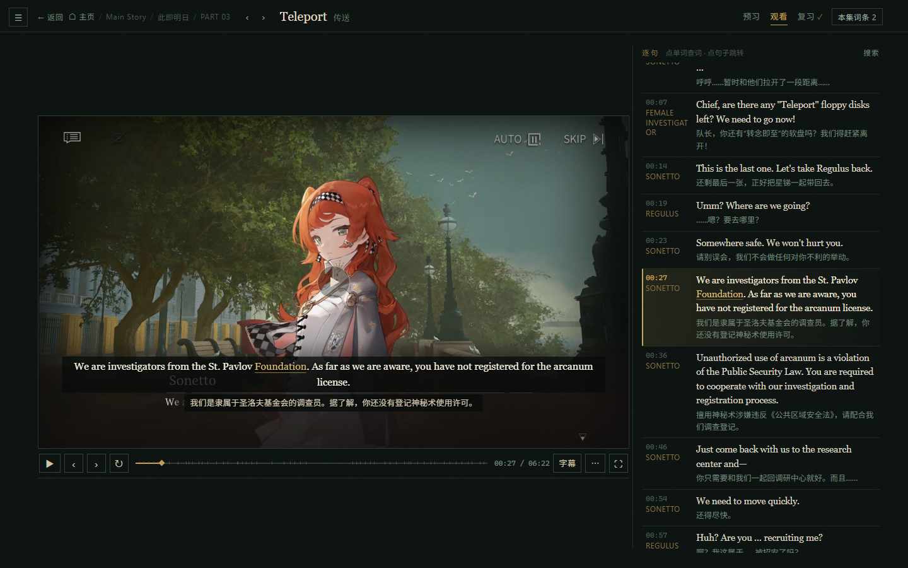

# 回溯（Huisu）

《重返未来：1999》视频精读工具。围绕每个 Part 的原片、双语字幕和句子上下文，完成预习、观看、查词和间隔复习；内置 UTTU 资源提取器。



## 特性

- **按 Part 精读**：片库按主题 → 章节 → Part 分层，每个 Part 保留原片、英中字幕、说话人和时间轴。
- **查词不脱离上下文**：点字幕里的单词，右侧打开词典与来源句子；可收录句子、写备注、跳回视频。
- **间隔复习**：待温习队列、掌握度、评分和来源重听。
- **内置资源提取器**：选择 Part 后直接提取切分视频与双语字幕；完整录像会缓存并复用于同录像的其他 Part。
- **原生 Windows 窗口**：不依赖浏览器，自带明暗主题，支持窗口缩放和自绘标题栏。

## 安装

### Windows 安装包

从 [Releases](https://github.com/syvvin/huisu/releases) 下载 `回溯-0.0.1-win64-setup.exe`。安装时可选择任意目录；安装包自带 Python、WebView2、ffmpeg、yt-dlp、ECDICT 和资源提取器。

### 源码运行

需要 Python 3.10+，以及资源提取所需的 `ffmpeg / ffprobe / yt-dlp`：

```powershell
python -m pip install -r requirements.txt
.\run.ps1
```

仓库不提交 `data/dict/ecdict.db`（约 97 MB）和用户数据；生成方法见 [构建说明](docs/BUILD.md)。

## 使用说明

详细的片库、预习、观看、查词、复习、词库、资源提取和设置说明见 **[docs/USAGE.md](docs/USAGE.md)**。

构建、数据准备和安装包制作见 **[docs/BUILD.md](docs/BUILD.md)**。

## 数据来源与第三方项目

- **视频、剧本与双语字幕**：UTTU 站点 <https://uttu.merui.net> 及 YouTube 上的游戏录像；资源提取器基于 `uttu-extractor`。
- **离线词典**：ECDICT，MIT License，<https://github.com/skywind3000/ECDICT>。
- **CEFR 数据**：Words CEFR Dataset / cefrpy，MIT License，<https://github.com/Maximax67/Words-CEFR-Dataset>。
- **英英释义与例句**：Wiktionary / Free Dictionary API。
- **中文释义、词源、词形、例句等**：有道词典公开页面接口，结果会缓存。
- **运行时与打包**：Python、pywebview、Microsoft WebView2、PyInstaller、Inno Setup、ffmpeg、yt-dlp、requests、BeautifulSoup、lxml。

游戏视频、字幕、图片和文本版权归原权利人所有。本项目仅用于个人学习，不分发游戏资源。

## 版本

0.0.1
