# 回溯 · Part 精读词卡


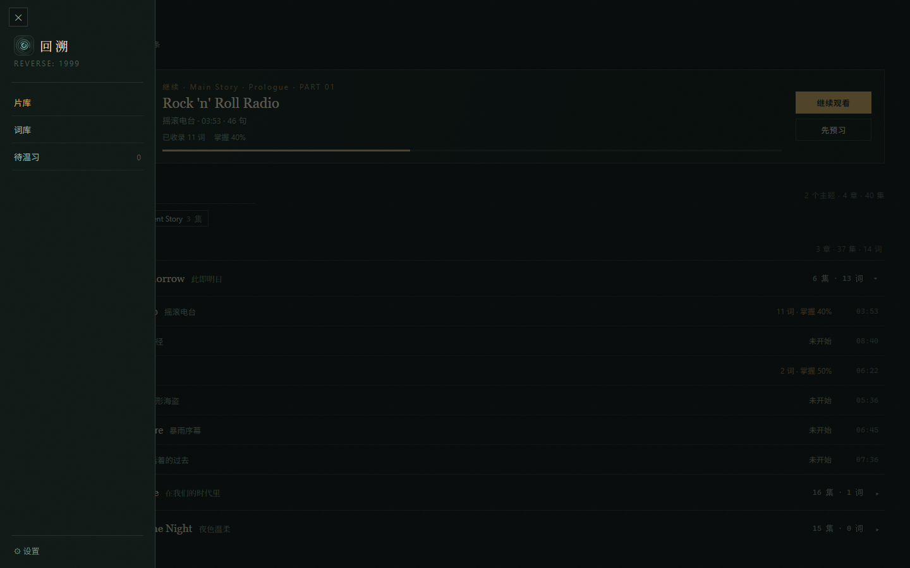

围绕 `uttu-extractor` 已经提取好的**每一个 Part 视频**来背单词。

**预习**（先挑生词）→ **观看**（边看边点词收录）→ **复习**（回到原片语境，按记忆曲线回来）。

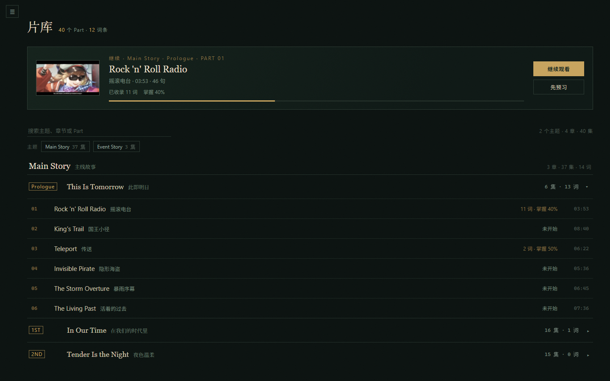

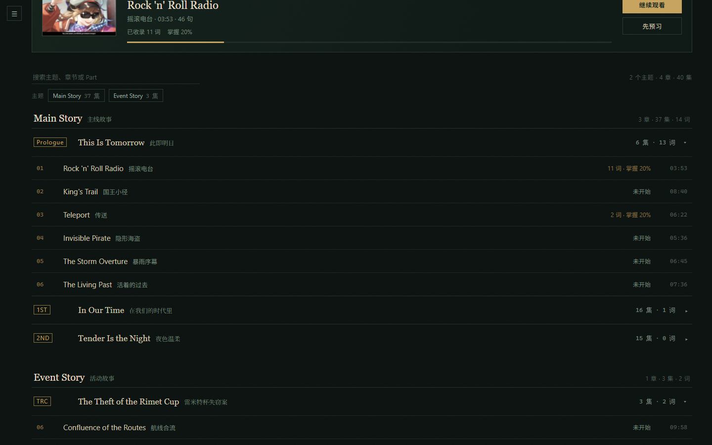

## 界面原则：一条主线，按需展开

- **没有顶栏**：片库、词库、待温习、设置都收进左上角的抽屉，平时只留一个 `☰`。
- **一屏只做一件事**：片库只负责选片，Part 页只负责这一集；Part 的标题、章节、上下集和三个阶段压缩在同一行。
- **视频与逐句并排**：左边是画面，右边是双语字幕，中间的分隔线可以**左右拖动**，比例会记住。
- **查词不打断字幕**：点单词后词典从右侧推入，视频与字幕整体让位，三栏并存；关掉词典，视频恢复原来的宽度。
- **跳转视频可原路返回**：在词典来源里点「跳转视频」后，视频页左上角有「← 返回」和「⌂ 主页」。返回会还原跳转前的词条面板、面板滚动位置、视频播放位置和字幕位置；应用内返回键和后退都走同一套恢复逻辑。
- **音标只在词典里**：词头不再重复一行音标；每个词典卡片保留自己的音标。词头有英 / 美两个发音按钮，设置里可选默认口音和查词自动播放。
- **基础控制留在外面，进阶选项收进去**：播放 / 上一句 / 下一句 / 单句循环 / 进度；字幕模式、遮中文在「字幕」菜单里，语速、静音在「⋯」菜单里。
- **词典按引擎分卡片**：每个词典单独一张卡，卡片里只显示设置中勾选的内容；音标、释义、词源、同根词、例句、真题各有明确分区，不再混在一起。
- **同根词/近义词可返回**：在词典里点同根词或近义词跳到另一个词后，左上角会出现「← 返回上一个词」；返回时保留之前的词条和面板滚动位置。
- **词典内容可自定义**：设置里每个词典卡片直接列出内容，勾选任意一条就启用该词典，不需要先勾选词典前面的框。
- **查词面板统一排序**：词典、我的备注、来源句子在同一个列表里，用 ↑↓ 调整先后；我的备注可以单独开关显示。来源句子内部还可以选「当前 Part 优先 / 按主题章节 / 最近收藏优先」。
- **来源播放器不切片段**：直接用本集完整视频，前后上下文都能拖；从本句开始，到句末自动暂停，点「▶ 继续」可继续看完整视频。手动拖到句末之后不会被误暂停；「↺ 回到本句」随时回收藏句并重新启用句末暂停。
- **一个词可以有多句来源**：第一次收藏记下当前句；同一集再次遇到这个词，可以点「＋ 收录这句话」把新句子加入同一条词目，跨 Part 的来源也会归在一起。
- **片库按主题 → 章节 → Part 分层**：`main`、`event`、`character` 等主题目录都会被扫描；顶部主题条可快速跳转，不再只看 Main。
- **来源也按主题 → 章节 → Part 分层**：全部默认展开，不再折叠；每个 Part 一张卡，当前句高亮，当前 Part 边框高亮。
- **词库先给决策信息**：单词、释义、掌握度；忽略和删除弱化在行尾。
- **章节默认只展开当前章**，片库不会一屏铺满 40 个 Part。


## 为什么以 Part 为单位

每一集 Part 都有自己的视频、英中双语字幕、说话人和时间轴。单词不是脱离上下文的卡片，而是
「**这个词出现在这一集的哪一句、谁说的、当时是什么画面**」。复习时点一下就能重听原句；卡片上的「详细信息」打开同一份词典与来源列表。

## 快速开始

源码运行：Python 3.10+。核心应用只用标准库；内置资源提取器需要 `requests / beautifulsoup4 / lxml / yt-dlp`，以及 PATH 中的 `ffmpeg / ffprobe`。安装包会把这些全部打包。

```powershell
cd uttu-vocab
python -m pip install -r requirements.txt
.\run.ps1            # 或: python packaging\launcher.py
```

> 仓库不提交 `data/dict/ecdict.db`（约 97 MB）和用户数据；首次从 GitHub 克隆后按「重建离线词典」生成或放入该文件。

启动后是一个原生桌面窗口（内嵌 WebView2），不打开浏览器标签页；后台仍在本机 8766 端口提供界面服务。

窗口使用自绘标题栏：颜色跟随明暗主题，可拖动标题栏移动窗口，右上角有最小化 / 最大化 / 关闭；拖动窗口边缘或四个角可以调整大小；视频全屏时标题栏自动隐藏。

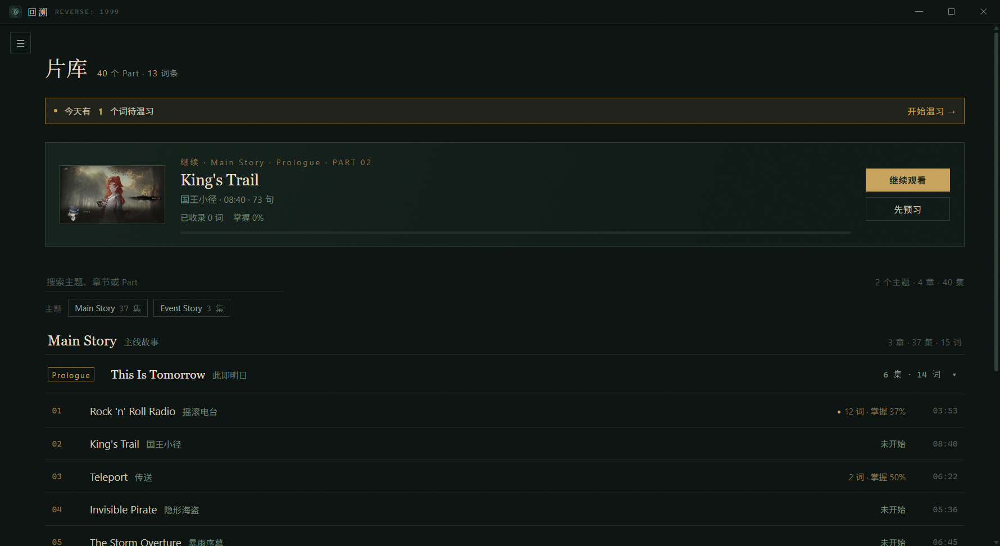

默认读取同级目录的 `uttu-extractor/output`。如果目录不同：右上角 ⚙ → **片库目录** → 保存并扫描。

首次启动会自动扫描 `output` 下所有主题目录（`main`、`event`、`character`、`anecdote`、`other`、`cn`）里的
`part.json`，把 Part、双语字幕、时间轴和说话人写进本地 SQLite（本机当前 2 个主题 / 4 章 / 40 个 Part；
其他主题在提取出本地视频后会自动出现）。

## Windows 安装包（0.0.1）

```powershell
.\packaging\build.ps1
```

产物：`release\回溯-0.0.1-win64-setup.exe`。

安装包自带 Python、ffmpeg / ffprobe、yt-dlp、ECDICT、CEFR 和资源提取器，安装后打开的是**原生桌面窗口**，不会拉起浏览器。

安装向导会显示目录选择页，可以装到任意盘（例如 `D:\回溯`），默认 `%LOCALAPPDATA%\Programs\回溯`。首次安装会按需准备 WebView2 运行时。用户数据写到 `%LOCALAPPDATA%\回溯\data`；片库默认 `%USERPROFILE%\Videos\回溯`，可在设置里改。

构建机器需要：Python 3.12、PyInstaller、pywebview/pythonnet、Inno Setup 6、PATH 中的 ffmpeg/ffprobe/yt-dlp，以及 `data/dict/ecdict.db`、`vocab/data/cefr.json.gz`。

## 亮色主题

侧栏底部的 ☼ / ☾，或设置 → **外观**，可以在夜间档案室和羊皮纸亮色之间切换。亮色使用墨绿、黄铜、珊瑚和纸张纹理，接近《重返未来：1999》的档案美术。

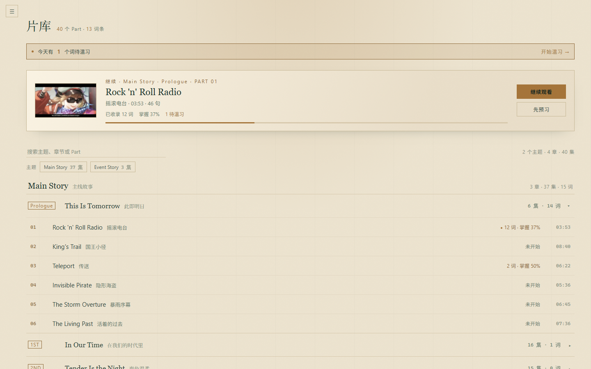


## 资源提取

应用内置了 `uttu-extractor`（在 `extractor/` 子目录）。侧栏「资源」会启动本地提取器界面：

- 选择分类 / 章节 / Part，直接提取切分视频和双语字幕；
- 输出目录就是当前片库目录；
- 提取完点「重新扫描片库」，Part 会直接出现在片库；
- 需要联网访问 UTTU 站点和 YouTube；
- 安装包已带 `requests / bs4 / lxml / yt-dlp / ffmpeg / ffprobe`。

提取器里的 Part 勾选只在当前页面会话中有效；关闭应用或重新进入资源页会清空，不会恢复上次的勾选。

### 源视频缓存

- 完整录像只下载一次，保存在本机源视频缓存中；之后提取同一个录像里的任何 Part（分辨率相同）都直接裁切，不会重复下载整段长视频。
- 会自动发现旧版 `uttu-extractor/data/cache/media` 里的完整录像，同盘时用 NTFS 硬链接接入应用缓存，不额外占磁盘；跨盘时直接复用旧路径。旧目录本身不会被删除。
- 资源页会显示缓存大小和完整 / 未完成数量，并提供「清理应用缓存」；最近 5 分钟内仍在写入的文件会跳过，未完成的 `.part` 可用于断点续传。
- 不同分辨率分别缓存；选择 720p 不会复用已有的 1080p 源，按当前分辨率重新获取。

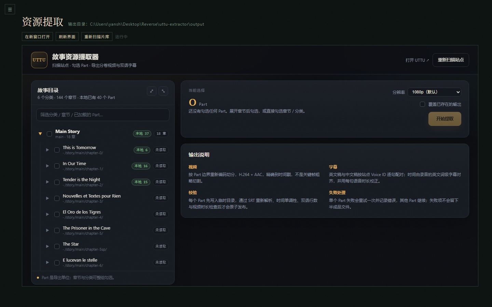

## 一个 Part 的三步

### 预习

按 **CEFR 级别**筛选生词候选（A1–C2 可多选），排除已收录词、功能词和人名。
每行带 CEFR 徽标和本集第一句原句；点单词先看词典，点 ＋ 收进本集。
级别在预习页顶部或设置里选择，保存一次后所有 Part 共用，不需要每集重设；默认 B1 + B2。

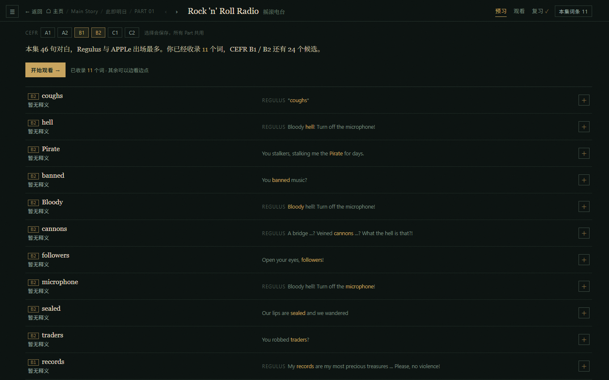

### 观看

- 左边画面占满可用宽度，右边逐句字幕；当前句高亮并自动滚动。
- **拖动中间的分隔线**可以随时调整视频与字幕的宽度比例，下次打开沿用。
- 画面上的悬浮字幕可以**按住拖动**到任意位置；`字幕 → 字幕样式…` 分「英文 / 中文 / 通用」三组：中英文各自调字号、颜色（含自定义取色）、背景深度、字重、字体，通用里调阴影、对齐、重置位置；带实时预览，全部自动记住。
- 点字幕任意单词 → 右侧推入词典（三栏并存，字幕不会被盖住）；点句子跳转；`↻` 单句循环 ×3 / ∞。
- 已经收录的词，同一集再次遇到时，词典里会多出「＋ 收录这句话」，把新句子加入同一个词目。
- 「字幕」菜单：双语 / 仅英文 / 仅中文 / 关闭。选「中文」后，画面字幕只显示中文；右侧逐句**只保留当前句的中文**，其余行改为英文，避免提前看到后面的中文；选「英文」时右侧隐藏中文。
- 「遮住中文」会把中文模糊；**点画面或右侧任意一句的中文**即可显示中文，当前句与后续句都会保持显示，再点一次重新遮住。
- 「⋯」菜单：0.75×–1.5× 变速、静音。
- 播放位置自动保存，下次从上次的位置继续。
- 右上角「本集词条 N」随时打开本集词表；再点任意词条即可查词。
- 全屏时点单词不再拉起右侧词典，而是在画面右上角显示一张 400×560 的浮窗；关闭浮窗或退出全屏后回到右栏。
- 全屏浮窗打开时，**Esc 先关浮窗，再按一次才退出全屏**。首次使用 Chrome 若询问键盘锁定权限，请选择允许（`Keyboard Lock` API）；长按 Esc 仍会按浏览器安全策略直接退出。


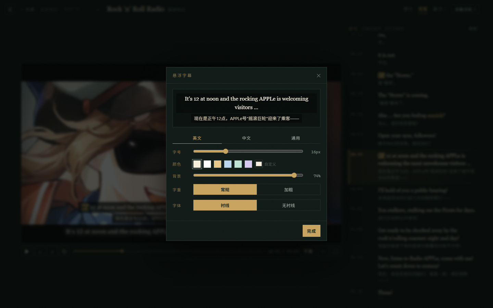

### 复习

两种模式，都基于原片语境：

- **语境填空**：给出原句，目标词被横线遮住，先回忆再看答案。
- **看词回想**：只看单词与音标，回忆释义，再看原句。

三个判定：`1 忘了` / `2 模糊` / `3 记得`。间隔为 10 分钟 / 1 / 2 / 4 / 8 / 16 天，掌握度是 5 格进度。
卡片上可以重听原句；「详细信息」打开与查词相同的词典面板，列出所有来源句子，可原地打开本集视频并回到本句，或跳到视频。
「重听原句」可以连续点，新的播放会取消上一段；切到下一张卡片时上一段的音频也会立即停掉，不会串音或半路中断。

复习页顶部可以在**到期复习**和**全部词**之间切换；到期为空时也能直接复习全部。会话中有进度条、计数器、正确率和「跳过」，评完以后可以：

- **再刷本轮**：同一批卡片立即重刷，不会因为已经排到明天而无法继续；
- **只练没记住的**：把本轮「忘了 / 模糊 / 跳过的」单独再练；
- **复习全部词 / 复习到期词**：直接切换队列；
- **回到观看 / 回到片库**。

支持 `空格` 显示释义、`1/2/3` 评分、`S` 跳过、`R` 重听、`P` 发音；卡片上还有单词发音、原句重听和详细信息。

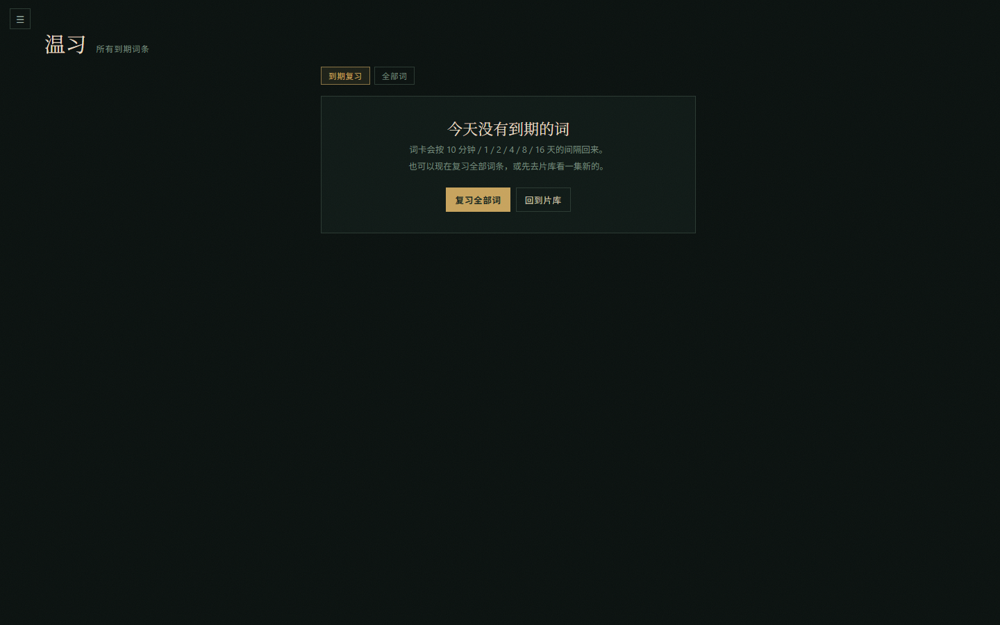

## 词典引擎（可多选）

设置 → **查词面板**：从上到下就是查词时的显示顺序；每个词典卡里直接勾选要显示的内容，勾选任意一条就启用该词典，不需要再单独勾选词典。我的备注、来源句子也在同一个列表里。查词时并行请求启用的引擎，结果按引擎分卡片展示：

| 引擎 | 内容 | 说明 |
| --- | --- | --- |
| 本地词库 | 音标、中文释义、英文释义、词形、考纲标签、词频 | ECDICT，77 万词条，完全离线 |
| 有道词典 | 英/美音标、中文/英文释义、词形、标签、词源、同根词、近义词、例句、真题 | 公开 JSON 接口，结果缓存 30 天 |
| Free Dictionary | 音标、英英释义、例句、同义词、词源 | 需要联网 |
| CEFR 词表 | CEFR 级别、词性级别、语料词频 | 本地内置 Words CEFR Dataset（A1–C2） |

每个内容分区都可以单独关闭；例如只看 ECDICT 的中文释义和 CEFR 级别，不看在线词源。
面板底部还有 **必应 / 欧陆 / 有道** 外链，遇到游戏自造词可以一键跳转。

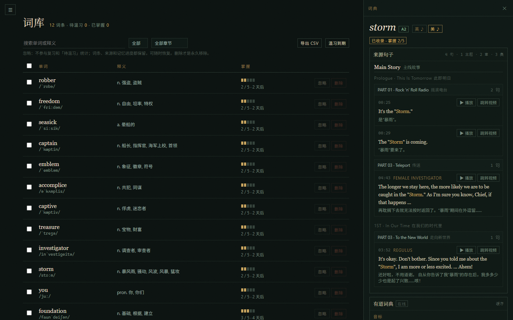

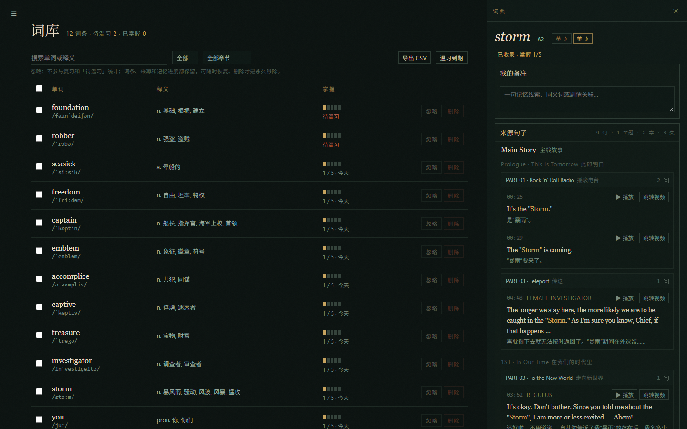

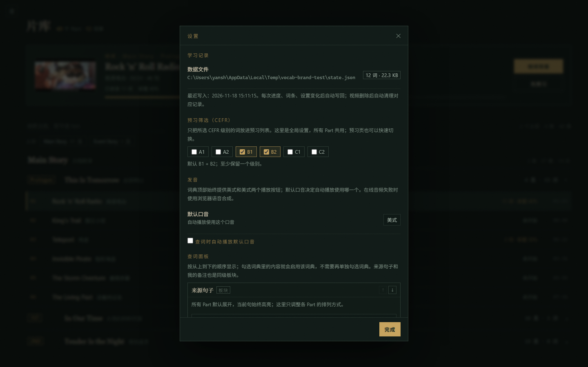

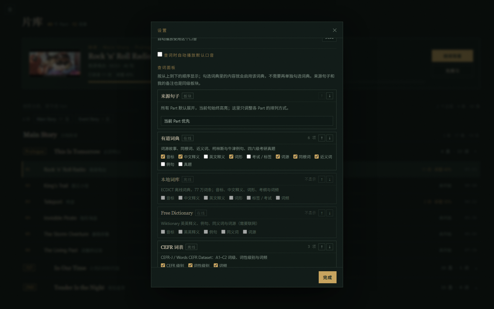

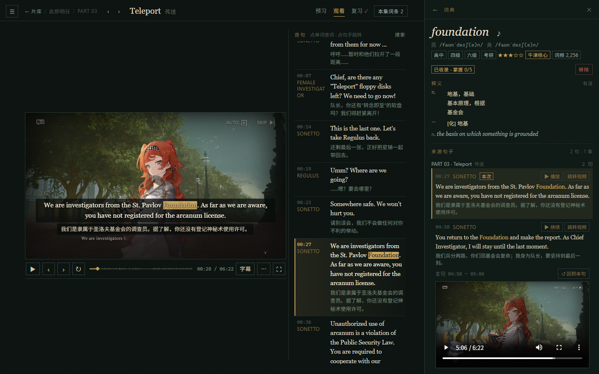

## 词库

- 搜索单词或释义，按状态、章节筛选。
- 勾选行首复选框可以批量处理：**忽略 / 恢复 / 删除**；表头可全选本页，选中后出现批量操作栏。
- 每行只给单词、音标、释义、掌握格与到期时间；单条忽略 / 删除在行尾。
- **忽略**只是把词条移出复习和「待温习」统计，词条、来源句子、备注和记忆进度都保留，随时可以恢复；**删除**才会永久移除。
- 点单词打开词典；从词库打开时只能查看来源，不能收录（收录要回到某一集）。我的备注和来源句子都是查词面板里的同级板块，可以在设置里调顺序；每条来源都能播放本集视频并回到本句，或跳到视频。
- 支持导出 CSV（`/api/export.csv`）。

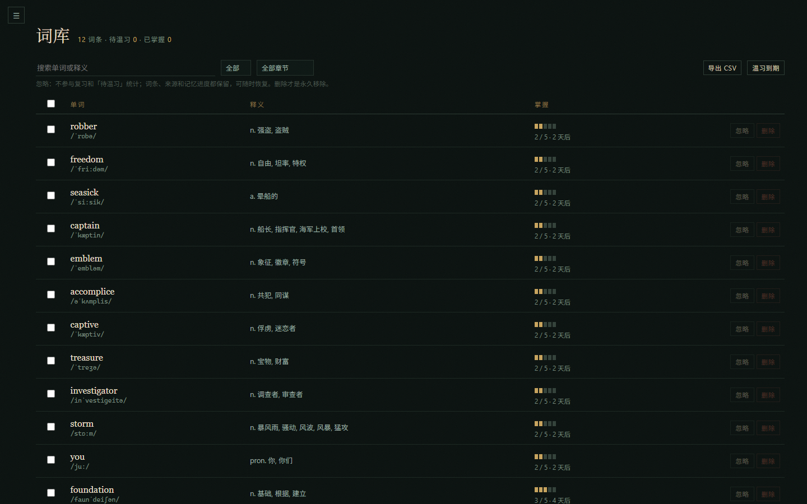

## 快捷键

| 场景 | 键 | 作用 |
| --- | --- | --- |
| 观看 | `空格` | 播放 / 暂停 |
| 观看 | `← / →` | 上一句 / 下一句 |
| 观看 | `L` | 单句循环（关 → ×3 → ∞） |
| 观看 | `R` | 重听本句 |
| 观看 | `F` | 全屏 |
| 观看 | `Esc` | 关闭菜单 / 词典面板 / 导航抽屉 |
| 复习 | `空格` | 显示释义 |
| 复习 | `1 / 2 / 3` | 忘了 / 模糊 / 记得 |
| 复习 | `S / R / P` | 跳过 / 重听原句 / 单词发音 |

## 目录结构

```
uttu-vocab/
├─ run.ps1 / run.bat        # 启动
├─ vocab/                   # 后端（应用核心为 Python 标准库）
│  ├─ server.py             # HTTP、JSON API、视频 Range、缩略图
│  ├─ extractor_bridge.py   # 在应用进程内启动内置资源提取器
│  ├─ library.py            # 扫描输出目录、同步 Part 与字幕、生词候选
│  ├─ study.py              # 词条、记忆曲线、复习队列、词库
│  ├─ ecdict.py             # 离线词库、词形还原
│  ├─ cefr.py               # CEFR 词级查询
│  ├─ text.py               # SRT 解析、说话人、分词
│  ├─ dicts/                # 词典引擎：ecdict / youdao / freedict / cefr
│  └─ data/cefr.json.gz     # CEFR 数据（压缩，含 MIT License 文件）
├─ extractor/               # 内置 UTTU 资源提取器（uttu 包 + web）
├─ packaging/               # launcher.py / 回溯.spec / installer.iss / build.ps1
├─ web/                     # 前端（原生 ES Modules，无构建）
│  ├─ index.html
│  ├─ logo.svg / favicon.*
│  ├─ css/style.css
│  └─ js/
│     ├─ main.js            # 路由、抽屉导航
│     ├─ dictpanel.js       # 右侧滑出：词条 / 词典
│     └─ views/             # library / part / watch / preview / review / wordbook / extract
├─ data/                    # 源码运行时的用户数据
│  ├─ state.json            # 词库、备注、进度、设置、复习记录（唯一数据文件）
│  ├─ vocab.db              # 片库/字幕/词典缓存（可重建的运行时索引）
│  ├─ dict/ecdict.db        # 离线词典（构建产物，约 97 MB）
│  └─ thumbs/               # 每个 Part 的缩略图（ffmpeg 生成，按需）
├─ release/                 # 安装包产物
└─ tools/                   # build_ecdict.py / build_cefr.py
```

所有学习记录都在 `data/state.json` 这一个 JSON 文件里：**词库、备注、掌握度、复习记录、观看进度和设置**。每次进度、词条或设置变化后自动写回；服务重启时从 JSON 恢复；视频从片库删除后，对应进度和词条关联会自动清理。`data/vocab.db` 只是片库/字幕/词典的运行时索引，删掉也能从 JSON 恢复学习记录。
启动时如果发现运行时索引里的词条比 JSON 多（例如状态文件是旧的/不完整的），会保留索引并从索引重建 JSON，不会反向清空索引。

安装版把这份数据放在 `%LOCALAPPDATA%\回溯\data\state.json`，片库默认 `%USERPROFILE%\Videos\回溯`；源码运行仍用仓库里的 `data/state.json`。

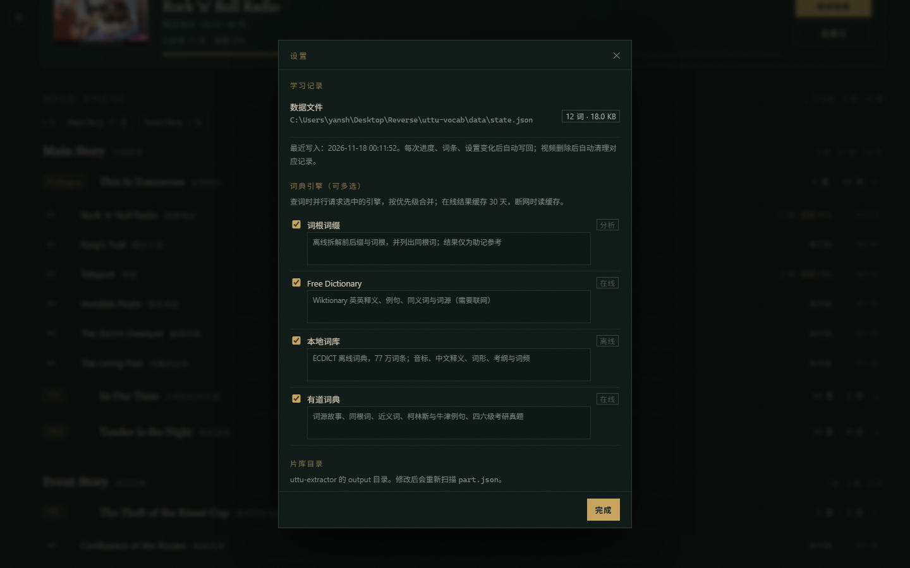

## 重建离线词典

```powershell
# 下载 https://raw.githubusercontent.com/skywind3000/ECDICT/master/ecdict.csv
# 放到 tools/ecdict.csv，或 --csv 指定
python tools/build_ecdict.py
```

约 8 秒构建出 77 万词条 + 5.8 万条词形映射。

## 重建 CEFR 数据

`vocab/data/cefr.json.gz` 已内置；如需从 Words CEFR Dataset 的 CSV 重建：

```powershell
python tools/build_cefr.py `
  --words words.csv --word-pos word_pos.csv --pos-tags pos_tags.csv `
  --out vocab/data/cefr.json.gz
```

三个 CSV 来自 <https://github.com/Maximax67/Words-CEFR-Dataset>（MIT）。构建结果约 3.4 MB，包含 17 万词的级别、词性级别和词频。

## 测试

```powershell
python -m unittest discover -s tests -v
```

覆盖 SRT 解析、说话人拆分、分词偏移、不规则词形还原与 CEFR 数据（不联网）。

安装包构建：

```powershell
.\packaging\build.ps1
```

## 数据来源与许可

- 视频、英中字幕、Part 标题与说话人：`uttu-extractor` 的提取结果（仅用于个人学习）。
- 中文释义、音标、词频、词形：**ECDICT**，MIT License，<https://github.com/skywind3000/ECDICT>。
- 词源、同根词、真题、柯林斯/牛津例句：有道词典公开页面接口，按个人查词频率使用并缓存。
- 英英释义与部分例句：Wiktionary / Free Dictionary API。
- CEFR 词级、词性级别与频率：**Words CEFR Dataset / cefrpy**，MIT License，<https://github.com/Maximax67/Words-CEFR-Dataset>。

## 与参考 UI 的差异

参考稿的暗色档案感和「左片库 / 中视频 / 右词条 / 正面词卡」思路保留，但把常驻栏位和用不上的功能删掉了：

- 删除：顶栏、常驻左片库栏、常驻右词条栏、Part 头部四行元信息、收藏本集、A–B 循环、
  含糊的「精听模式」开关、覆盖视频的悬浮小卡、装饰性的假集数/假词数。
- 补全：抽屉式导航（片库 / 词库 / 待温习 / 资源 / 设置）、独立的片库页（章节折叠）、单行 Part 头部、
  可拖动的视频/字幕分隔线、按需推入的词典与词条、真实章节标签与中英文标题、预习阶段、
  字幕筛查、续播、单句 ×3/∞、遮中文、音量、上一集/下一集、词典多引擎与来源状态、备注、
  词库筛选/忽略/删除/导出、目录设置与重扫、空状态与错误提示。
- 渐进式披露：播放器的进阶选项进菜单；词典内容按引擎分卡片；词库的维护操作弱化到行尾。
- 内置资源提取器和亮色主题；安装包自带运行时依赖。

## 已知限制

- 资源提取需要联网访问 UTTU 站点和 YouTube；提取失败不会留下半成品文件。
- 视频本身带有游戏内字幕，应用的双语叠层会位于画面偏上位置，避免直接盖住。
- 有道 / Free Dictionary 是公开网页接口，可能限流；失败时退回本地词库与缓存，不影响学习记录。
- CEFR 级别来自词级数据，不区分具体上下文里的词义；多词性词条会在词性级别里展开。
- 仅在本机使用（默认只监听 127.0.0.1），没有账号系统。
