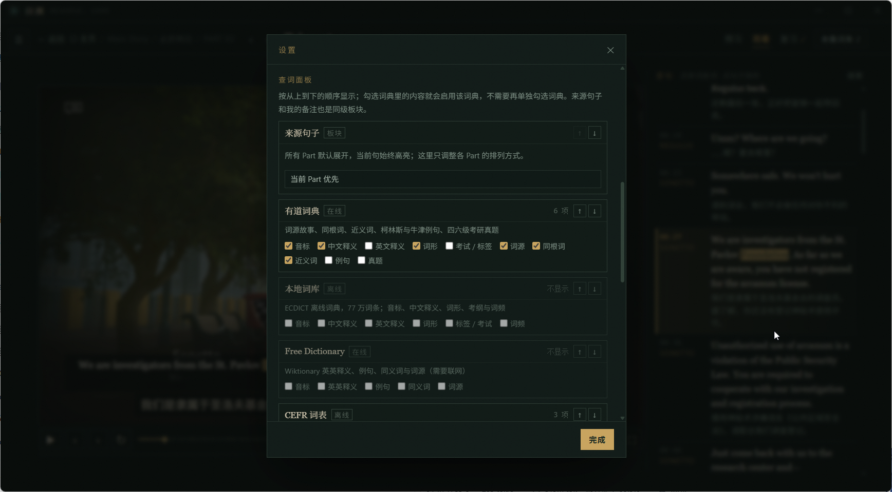

# 回溯（Huisu）

《重返未来：1999》视频精读工具。以每个 Part 的视频为单位，按 **预习 → 观看 → 复习** 的流程学习；内置资源提取器，把视频、双语字幕和单词放回真实语境里。


## 特性

| 截图 | 特性 | 说明 |
| --- | --- | --- |
|  | **预习 · 观看 · 复习** | 按 Part 组织学习。预习时按 CEFR 难度筛选生词，观看时看双语字幕，最后进入间隔复习。 |
|  | **内置资源提取器** | 选择章节或 Part，直接提取切分视频与英中字幕；完整录像会缓存并复用于其他 Part。 |
|  | **双语字幕 + 点击查词** | 视频与逐句字幕并排；点单词立即查词。已收藏的词会在字幕里高亮，不打断观看。 |
|  | **可自定义的查词面板** | 词典、来源句子、备注可以调顺序；每个词典显示哪些内容也能逐项选择。 |
|  | **一个词，多句来源** | 同一个词可以收藏多个句子，每句附带原视频片段；词库集中管理掌握度、备注和来源。 |
|  | **两种温习模式** | 语境填空或单词卡；显示释义后按「忘了 / 模糊 / 记得」评分，自动安排下次复习。 |

## 安装

### Windows 安装包

从 [Releases](https://github.com/syvvin/huisu/releases) 下载 `huisu-0.0.1-win64-setup.exe`。安装时可选择任意目录；安装包自带 Python、WebView2、ffmpeg、yt-dlp、ECDICT 和资源提取器。

### 源码运行

需要 Python 3.10+，以及资源提取所需的 `ffmpeg / ffprobe / yt-dlp`：

```powershell
python -m pip install -r requirements.txt
.\run.ps1
```

仓库不提交 `data/dict/ecdict.db`（约 97 MB）和用户数据；生成方法见 [构建说明](docs/BUILD.md)。

## 使用说明

片库、预习、观看、查词、复习、词库、资源提取和设置的详细说明见 **[docs/USAGE.md](docs/USAGE.md)**。

构建、数据准备和安装包制作见 **[docs/BUILD.md](docs/BUILD.md)**。

## 数据来源与第三方项目

- **视频、剧本与双语字幕**：UTTU 站点 <https://uttu.merui.net> 及其在 YouTube 上发布的游戏录像。
- **离线词典**：ECDICT，MIT License，<https://github.com/skywind3000/ECDICT>。
- **CEFR 数据**：Words CEFR Dataset / cefrpy，MIT License，<https://github.com/Maximax67/Words-CEFR-Dataset>。
- **英英释义与例句**：Wiktionary / Free Dictionary API。

游戏视频、字幕版权归原权利人所有。本项目仅用于个人学习。

## 许可

MIT License，见 [LICENSE](LICENSE)。游戏素材版权归原权利人所有，不包含在本许可证内。

## 版本

0.0.1
